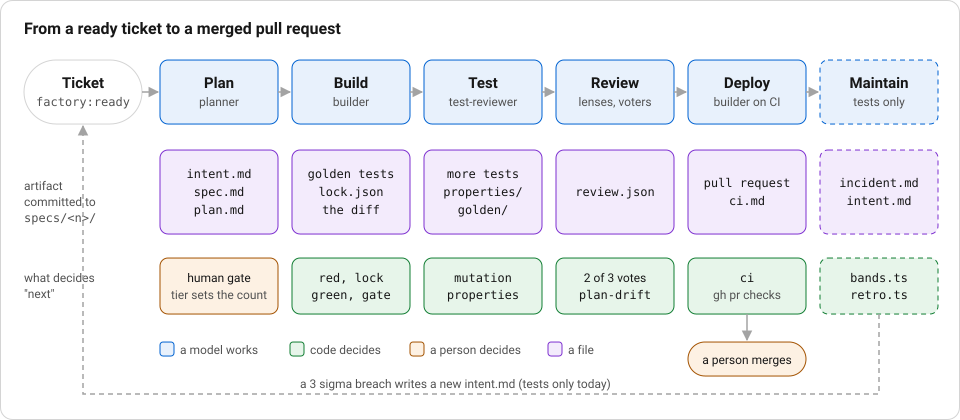

# F0 Overview: from a ticket to a merged pull request

**Stage:** the whole path. **Layers:** all of them. **Workflows:** every file in `.factory/workflows/`.

## Story

**The ticket.** Issue 35 asked for a prompt cache and templates learned from good worksheets. Every stage left a file in `specs/35/`.

**Without the layer.** The builder added `api/src/agent/template-eval.ts` and wrote in `specs/35/build.md` that it was "not on the plan's file list". A builder working alone would have shipped a file nobody had agreed to.

**What the layer did.** The `plan-drift` check failed the run: "check plan-drift FAIL: files outside plan.md: api/src/agent/template-eval.ts", as `specs/35/ci.md` quotes it. The plan was updated to list the file, and the check passed.



_Notice:_ only the plan gate and the merge are orange. Every other step forward is decided by code reading a file or an exit code.

## Goal

Say in one page what the factory does, which parts are code and which are a model, and how it compares with the two public descriptions of an agentic software factory. By the end you can name the artifact each stage leaves behind and the check that decides whether the next stage may start.

## The path

A ticket moves through stages. Each stage commits one artifact under `specs/<n>/` and the next stage reads only what was committed, so the commit history is the audit trail.

| Stage    | Artifact                          | What decides "next"                      |
| -------- | --------------------------------- | ---------------------------------------- |
| Plan     | `intent.md`, `spec.md`, `plan.md` | a human gate, and `plan-drift` later     |
| Build    | tests, then the diff, `lock.json` | `red`, `lock`, `green`, `acceptance`     |
| Test     | more tests, mutants               | `mutation`, `properties`, `holdout`      |
| Review   | `review.json`                     | lenses, then verifiers that vote         |
| Deploy   | the pull request, CI              | `ci`; `deploy.ts` is tests only          |
| Maintain | `incident.md`, a new `intent.md`  | `bands.ts` and `retro.ts` are tests only |

The large-feature workflow, `feature-sdd`, adds four Spec Kit stages to the plan row: `constitution.md` before the spec, `clarify.md` after it, then `tasks.md` and `analyze.md` after the plan. F2 covers them.

The names come from `ARTIFACTS` in `factory/engine/artifacts.ts` and `CHECK_NAMES` in `factory/engine/workflow.ts`. A workflow is a YAML file. `factory/engine/interpret.ts` runs its steps in order, repeats a step while its loop checks fail up to a cap, stops early as `needs-human` with the reason "test contradicts ticket" when two rounds in a row fail the same check with the same evidence (`sameFailure` on the loop), and writes `run.log` and `cost.json` under `specs/<n>/` when the run finishes or stops at a gate or a cap.

## What is code and what is a model

A model writes `intent.md`, `spec.md`, `plan.md`, the tests and the fix. Code decides everything that gates them:

- `red` runs the new tests on the base commit and fails if they pass.
- `lock` hashes every test file in state the agent cannot write.
- `plan-drift` fails a diff that touches a file `plan.md` does not list.
- `review.ts` keeps a finding only when at least two of its three verifiers vote for it. The `review` step of a real run calls it.
- `risk.ts` turns changed paths into a tier, and a human gate needs that tier's approvals: none for low, one for medium, two for high. An agent's approval never counts.
- `interpret.ts` stops a run once its spend reaches the configured share of the cap in `.factory/config.json`, and hands each call the money that is left.
- `bands.ts` turns a metric breach into an action with no model involved. Only tests call it so far.

The rule behind the list: a gate reads an exit code or a hash, never the model's word that it is done.

## What a real run does today

`npx tsx factory/engine/main.ts <issue> --workflow=<name>` runs these, each pinned by a test in `factory/engine`:

- It reads `.factory/config.yaml` once, before the first agent, so the commands the gate runs cannot be edited mid-run (F0.1).
- Each step gets a model from `.factory/config.json`, and `run.log` and `cost.json` record the model and the cost of every call (F12).
- The run stops as `needs-human` with the reason `spend cap` at the configured share of `spend.capUsd` (F13).
- A `review` step runs its lenses and the voting verifiers, and a builder fixes what survives, up to three rounds (F5).
- A `gate: human` step computes the risk tier from the files changed so far and waits for that tier's approvals (F1).
- `feature-sdd` runs the constitution, clarify, tasks and analyze stages (F2).

Not wired into a real run: deploy (`deploy.ts`), the sigma bands (`bands.ts`) and the retro (`retro.ts`). Tests exercise them, and a separate change is wiring them. F6 and F7 describe them as they stand.

After the stage modules come F8 (workflows), F9 (the capstone), F10 (assignments), F11 (cloud sessions), F12 (model routing) and F13 (spend and safety).

## Public factories, compared

The workshop is built from published descriptions. This table says where each idea lands here and where this repo does less.

| Idea     | Anthropic AI-native SDLC playbook and review post                                | OpenAI software factory (Pragmatic Engineer write-up)                    | This repo                                                                                |
| -------- | -------------------------------------------------------------------------------- | ------------------------------------------------------------------------ | ---------------------------------------------------------------------------------------- |
| Start    | an `intent.md` per stage, committed                                              | an outcome, then context                                                 | `intent.md` from the `intent` step, or from a sigma breach                               |
| Verify   | tests first, hooks that block test edits during a fix, evals gate prompt changes | CI is watched until it is green                                          | `red` and `lock`, `.claude/hooks/pretooluse-test-lock.mjs`, the `ci` check               |
| Review   | layered review, parallel hunters, agents that vote on each finding               | specialist reviewers                                                     | `factory/engine/review.ts`, `REVIEW.md`                                                  |
| Deploy   | autonomy tiered by environment, hooks as approval gates                          | an agent assists the deploy after a human approves                       | `factory/engine/deploy.ts`: production refuses without approvals, tests only             |
| Risk     | the tier comes from the change, not the author                                   | risk classification picks the path                                       | `classify` in `factory/engine/risk.ts`, applied at every human gate                      |
| Maintain | sigma bands turn a breach into a new intent                                      | observe, feed regressions back, an incident bot that acts only when told | `.factory/bands.yaml`, `detect` and `actionFor` in `factory/engine/bands.ts`, tests only |

This repo has no deploy target of its own: `release` calls `make deploy ENV=...`, and the Makefile here does not define that target. Treat F6 as a pattern to copy, not a pipeline that ships this app.

## The Founder's playbook

Anthropic also publishes a Founder's playbook. Its page holds only a table of contents (Idea, MVP, Launch, Scale); the body is a long PDF. Nothing in this workshop is built from it. This is the only mention: the factory here starts after the idea is already a ticket.

## Steps you run

1. Read the comment line above `name:` in `.factory/workflows/bug-tdd.yaml` and `.factory/workflows/feature-sdd.yaml`. Each names its method and source.
2. List the workflows: `ls .factory/workflows`.
3. Print the stages the older runner would run, with no spend: `make factory ISSUE=1 FLAGS=--dry-run`. It reads `.factory/config.json` and prints model, turns and budget per stage.
4. Run the engine's offline tests, which run every workflow against a fake host: `npx vitest run factory/engine`.
5. With `gh` signed in, `npx tsx factory/engine/main.ts --watch` lists issues labelled `factory:ready`. `npx tsx factory/engine/main.ts --report` rolls up saved `metrics.json` files and needs a `.factory/runs` folder from an earlier run.

A real run needs `gh` and one credential: an API key from the key source named in `.factory/config.yaml`, or a Claude Pro or Max subscription token from `claude setup-token`. `auth` in that file, or `--auth=` on the run, picks which; [Auth modes](auth-modes.md) covers both, what the terms allow and how each is capped. A key run spends tokens up to the cap in `.factory/config.json` and a subscription run stops at `subscriptionCap`, so read F1 first.

## Proof that bites

`factory/engine/review.test.ts` holds the risk and review rules. Open `factory/engine/risk.ts`, change the first HIGH pattern `/^\.github\//` to one that never matches, and run:

```
npx vitest run factory/engine/review.test.ts
```

Expect `risk > is high for a CI workflow and low for docs` to fail with `expected 'medium' to be 'high'`. Restore the pattern and it passes. The test is wired into `make check` through `npm test`.

## See it on a real run

`specs/26/` is a bug run through `bug-tdd`. `specs/26/golden/font-face.golden.test.ts` is the test written to fail first, `specs/26/lock.json` is the hash of every test file at that point, `specs/26/fix.md` is the fix stage's note, and `specs/26/plan.md` is the allowlist the diff was held to.

`run.log` is the file the engine writes last and commits with `specs/*/run.log` kept out of the `*.log` ignore; runs made before that change have none in the repo. `specs/35/ci.md` quotes one line from its run's log: `check plan-drift FAIL: files outside plan.md: api/src/agent/template-eval.ts`. That is `plan-drift` stopping a run, and `ci.md` records that the path was then listed in `plan.md`.

## Discussion

1. Which stage in your team's flow commits nothing the next stage can read, and what would you commit?
2. The OpenAI description has an agent assist the deploy after a human approves. `deploy.ts` holds the approval check but no run calls it yet. Where would you call it, and what would you add before you let an agent run `make deploy`?
3. Which gate here would you most want to turn off under deadline, and what does its failing test say you would lose?
