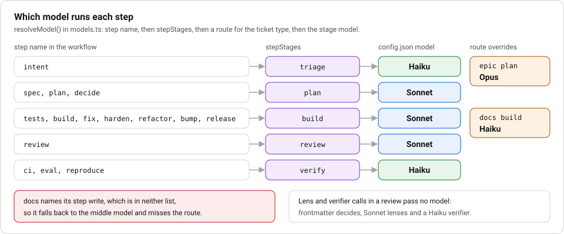

# F12. Model routing: the right model for each stage

**Stage:** plan, build, review, verify. **Layer:** execution, priced. **Prerequisite:** F8 (workflows) and the cost ledger described in the FAQ.

## Story

**The ticket.** The `docs` workflow. No run shows this one; the config and the workflow file do.

**Without the layer.** `routes.docs.build` in `.factory/config.json` sends a docs build to Haiku, but `.factory/workflows/docs.yaml` names its step `write`, which is not in `stepStages`. The route never applies and the step runs on the middle model.

**What the layer did.** `run.log` records the model on every round, so the miss is visible in a file, not hidden in a bill. The assignment "A model for every stage name" in F10 closes it.



_Notice:_ the red box is a route that never fires.

## Goal

Send mechanical stages to the cheap model, building to the middle model and epic planning to the strongest one, see why an agent file alone cannot do that, and measure the mix from `cost.json`.

## The rule of thumb

Spend the strongest model where one mistake is expensive and few tokens are used. Spend the cheapest where the step is mechanical and many tokens are used.

| Stage                      | Why                                              | Model tier |
| -------------------------- | ------------------------------------------------ | ---------- |
| triage, verify, adr, retro | read, classify, run a command, summarise         | low        |
| build                      | the longest stage, so the one that sets the bill | mid        |
| review                     | a second pair of eyes on a diff                  | mid        |
| plan for an epic, delivery | one plan shapes every sub-issue after it         | high       |

The repo already says this in `.factory/config.json`: triage, verify, adr and retro are Haiku 5.5, plan, build and review are Sonnet 5.5, and `delivery` is Opus 5.5. Prices are in the same file, in dollars per million tokens, and the model names are the three in `allowedModels`.

## Two places a model gets chosen

This repo has two runners, and both read `.factory/config.json`. Know which one you are in.

**The workflow engine** (`factory/engine/`, `npx tsx factory/engine/main.ts <issue> --workflow=<name>`). `runStep` in `factory/engine/interpret.ts` calls `resolveModel` in `factory/engine/models.ts` for every agent call of a step, and hands the result to the host. The order is:

1. `stepStages` in `config.json` maps the step's stage name to a config stage (`intent` to `triage`, `spec` and `plan` to `plan`, `tests`, `build` and `fix` to `build`, `review` to `review`, `ci` to `verify`, and so on). A stage name that is itself a config stage name maps to itself.
2. `routes.<type>.<stage>` overrides the stage's model for a ticket type. The type is the workflow name, except that `feature-sdd` runs as `epic` (`runIssue` in `factory/engine/cli.ts`). So an epic plans and writes its spec on Opus, and a `docs` run builds on Haiku when its step maps to `build`.
3. Otherwise `stages.<stage>.model`.
4. A stage name in neither list falls back to the middle model, not to a stage default. The `docs` workflow names its build step `write`, which is not in `stepStages`, so its route to Haiku does not apply. F10 has the assignment.

`run.log` records the model on every round (`build round 1 model claude-sonnet-5-5 $0.0123`), and `cost.json` lists one entry per call with the model and cost. The test `hands each step its config model and logs it in run.log and cost.json` in `factory/engine/models.test.ts` pins both.

What the engine does not route: the lens and verifier calls inside a `review` step. They pass no model, so `real-host.ts` takes the model from the agent's frontmatter (`reviewer` and the other lenses are Sonnet, `verifier` is Haiku).

**The older runner** (`factory/main.ts`, `factory/run.ts`, `make factory`). `stageFor` in `factory/config.ts` takes the stage's model from `config.json`, then lets `routes.<type>.<stage>` override it. After triage, `routeTicket` in `factory/route-ticket.ts` can move plan and build by size and risk:

- an epic, or any high-risk ticket, plans on `tiers.high` and builds on `tiers.mid`;
- a docs ticket, or a small low-risk one, plans and builds on `tiers.low`;
- everything else plans and builds on `tiers.mid`.

A missing or odd triage value counts as the costly case: `parseTriage` falls back to risk `high`. A stage that reports a model outside `allowedModels` throws, so a typo in a route cannot spend on a model you did not price.

## Why frontmatter alone piles one model everywhere

An agent file names one model, and a workflow step names an agent, not a stage. Without the resolver:

- `planner`, `builder`, `reviewer`, `design-reviewer`, `security-reviewer` and `test-reviewer` all say `model: sonnet`. Only `verifier` says `model: haiku`. No agent says `opus`.
- Every workflow reuses `planner` for its plan step and `builder` for its build step, so a one-line typo fix and a large feature would plan on the same model.

You could add `planner-opus.md` and `planner-haiku.md` and point workflows at them. That multiplies agent files, and the choice is still made by whoever wrote the YAML, before the ticket exists. The resolver decides from the stage and the ticket type instead, and the agent file's model is only the fallback when no config is passed.

## Steps

### 1. See the routes the older runner would use

```bash
npx tsx factory/main.ts 1 --dry-run
```

It prints each stage with its model, turn limit, budget and permission mode, for a `feature` ticket. It reads `.factory/config.json` and spends nothing.

### 2. Run the routing tests

```bash
npx vitest run factory/run.test.ts factory/cost-ledger.test.ts factory/cost-report.test.ts
```

Read these by name: "routes an epic plan to Opus", "lets the orchestrator overrule triage and force the Opus route", "routes a small low-risk ticket to the cheap model and a risky one to Opus" and "fails closed when a stage used a model outside the allowed set".

### 3. Change a route and watch a test notice

In a scratch branch, edit `.factory/config.json` and change `routes.epic.plan` from `claude-opus-5-5` to `claude-sonnet-5-5`. Run:

```bash
npx vitest run factory/run.test.ts -t "routes an epic plan to Opus"
```

It fails. Revert the edit and run it again; it passes. That is the proof that routing is pinned by a test and not by prose.

### 4. Measure the mix from `cost.json`

Each older-runner run writes `.factory/runs/<issue>/cost.json`, built by `buildLedger` in `factory/cost-ledger.ts`. The fields are `totalUsd`, `byStage`, `byModel`, `baselineModel`, `baselineUsd`, `savedUsd`, `savedPct` and `entries`, where each entry holds a stage, a model, token counts and a cost.

```bash
node -e 'const l=require("./.factory/runs/ISSUE/cost.json");console.log(l.byModel,l.byStage,l.savedPct)'
```

Replace `ISSUE` with a run you have. Read it three ways:

- `byModel`: what share of the dollars went to each tier. If Opus is most of it on a ticket that was not an epic, a route is too generous.
- `byStage`: which stage is the bill. If it is build, cheaper planning will not move it.
- `savedUsd`: the same tokens re-priced at `baselineModel` (Opus). It is arithmetic on token counts, so it says what routing saved, and it says nothing about quality.

`formatReport` in `factory/cost-report.ts` prints the same numbers as text, ending with the saving against all-Opus. When the SDK gives no token counts, `buildLedger` reports zero saved instead of inventing a number.

The workflow engine writes `specs/<issue>/cost.json` with `capUsd`, `totalUsd` and `calls`, one call per entry with `stage`, `round`, `model` and `costUsd`. Group `calls` by `model` to get the mix. Its `metrics.json` holds `costUsd` per run and per workflow through `rollup`, and no split by model; `npx tsx factory/engine/main.ts --report` prints that. The `byModel` and `savedUsd` fields above exist only in the older runner's `cost.json` under `.factory/runs/<issue>/`. Review lens and verifier calls are not in the engine's `calls`.

### 5. Decide with an experiment, not an opinion

The repo has no measured quality comparison between models on build. To get one, run the same issue twice, once with `stages.build.model` on Sonnet and once on Haiku, from a clean branch each time. Compare the check results in `run.log` and the cost in `cost.json`. A cheaper model that needs a second review round can cost more, so compare totals, and read the `rounds` in `metrics.json`.

## Proof that bites

The ledger must add up, and an unpriced or unlisted model must fail.

```bash
npx vitest run factory/cost-ledger.test.ts -t "sums to the reported total"
```

Now break it: in a scratch branch, delete the `claude-haiku-5-5` entry from `prices` in `.factory/config.json` and run `npx vitest run factory/cost-ledger.test.ts`. Those tests call `loadConfig()` when they import, and `configSchema` throws `model claude-haiku-5-5 has no price`, because a model without a price would make the ledger silently under-count. Restore the entry.

## Discussion

- Plan is cheap in tokens and expensive when wrong. Why does the config route the plan of an epic to Opus and not its build?
- The resolver ignores the model in an agent's frontmatter when a config stage exists. Is that the right precedence, or should an agent be able to pin its own model?
- Triage itself runs on the cheapest model. What goes wrong if triage is wrong, and which way does `parseTriage` fail?
- `savedPct` compares against all-Opus. Is that the baseline your team would have chosen without the factory?

## Sources

- [Manage costs effectively, choose the right model](https://code.claude.com/docs/en/costs.md)
- [Subagents, choose a model](https://code.claude.com/docs/en/sub-agents.md#choose-a-model)
