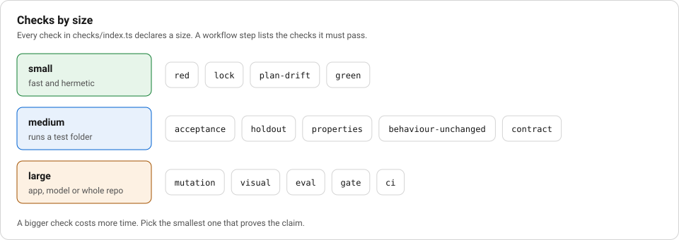

# F4 Test: evidence the model cannot talk its way past

**Stage:** test. **Layer:** verification. **Workflows:** `bug-tdd`, `feature-atdd`, `feature-bdd`, `feature-sdd`, `refactor`, `contract`, `ui-visual`, `llm-eval`.

## Story

**The ticket.** Issue 35, the red stage, in `specs/35/red.md`.

**Without the layer.** On the branch, "all 33 pass because the build is already here". A red check run on the branch would have seen green tests and proved nothing.

**What the layer did.** Checked on `main`: "31 of 33 fail, 2 pass", and the two that pass are guards that hold on both sides. So "the `red` check must run with `ref: base`", which is what `factory/engine/checks/red.ts` does.



_Notice:_ `red` and `lock` sit on the cheapest rung, and they decide whether the expensive checks above mean anything.

## Goal

Know which check proves which claim, run it at the right size, and see it fail on purpose. An agent optimises for whatever grades it, so each check below also names the trick it stops.

## The ladder

Every check lives in `factory/engine/checks/index.ts` and declares a size. The engine runs them from the `checks` and `loop.until` lists of a workflow step. The commands behind them are not written in the checks: they come from `.factory/config.yaml` (`tests.unit`, `tests.e2e`, `tests.eval`, `tests.mutation`, `tests.prepush`, `tests.prose`, `gate` and the `contract` and `holdout` paths), read once at the start of the run. A different repo supplies its own file and keeps the checks.

| check                 | size   | claim it proves                           | what it runs                                 |
| --------------------- | ------ | ----------------------------------------- | -------------------------------------------- |
| `red`                 | small  | the new test fails on the base commit     | `vitest run specs/<n>` at the base worktree  |
| `lock`                | small  | no test moved since it was recorded       | hashes every test file                       |
| `plan-drift`          | small  | the diff stays in `plan.md`               | reads the plan and the changed files         |
| `green`               | small  | the locked test passes                    | `vitest run specs/<n>`                       |
| `acceptance`          | medium | the examples or scenarios pass            | `vitest run specs/<n>`                       |
| `holdout`             | medium | cases the builder never saw pass          | `vitest run` on `paths.holdout/<n>`          |
| `properties`          | medium | a rule holds for generated inputs         | `vitest run specs/<n>/properties`            |
| `behaviour-unchanged` | medium | recorded output is byte-for-byte the same | `vitest run specs/<n>/golden`                |
| `contract`            | medium | both sides agree on the wire              | `vitest run` on `paths.contract`             |
| `mutation`            | large  | the tests notice a changed line           | `tests.mutation` on the changed source files |
| `visual`              | large  | layout, overflow and accessibility hold   | `tests.e2e` (`playwright test tests/e2e`)    |
| `eval`                | large  | model behaviour and its token cost hold   | `tests.eval` (`tsx api/src/eval.ts`)         |
| `gate`                | large  | the whole repo is green                   | the `gate` command (`make check`)            |
| `ci`                  | large  | the pull request is green                 | `gh pr checks --watch`                       |

Sizes follow the Google idea of small, medium and large. A small check is fast and hermetic. The size is a field on every check.

## TDD: red and lock

`red` is `factory/engine/checks/red.ts`. It runs the spec tests against the base commit and fails if they pass: "already passes on the base commit, so it proves nothing". This stops the test that was written to pass.

`lock` records a sha256 of every test file (`.test.ts`, `.e2e.ts`, `.feature`, anything under `tests/`) the first time it runs. The record is in runner state outside the worktree, so the builder cannot rewrite it; `specs/<n>/lock.json` is only a copy for the audit trail. A later call fails if a test changed or vanished. New tests may be added.

## Properties

A property states a rule for all inputs and a library generates them. `specs/34/properties/workbook.test.ts` uses fast-check to build workbooks of random size and band, and asserts what `specs/34/spec.md` says: every item lands on exactly one page, and no page exceeds `maxItemsPerPage`. The property needs a planted mutant to prove it can fail: remove the page split in `planWorkbook` and a counterexample prints.

## Characterization

For a refactor, you cannot write the behaviour from a spec, because the code is the spec. `refactor.yaml` records the current output first, with `behaviour-unchanged` and `lock` as the checks and no source change allowed. `specs/25/golden/render.golden.test.ts` records `renderWorksheet` for every band and keeps the HTML in `specs/25/golden/__snapshots__/`. A refactor that moves one byte fails.

## Mutation

Line coverage says a line ran, not that a test would notice if it were wrong. `mutation` runs Stryker only on the changed files under `shared/src` (a whole-repo score would punish a run for old gaps). `stryker.config.json` sets `thresholds.break` to 50, so a score below it fails the step. A file name with glob characters is refused so it cannot rewrite the mutate list. Stryker runs the unit tests beside the code and `specs/*/golden`, as `stryker.vitest.config.ts` says.

## Holdouts

A builder can overfit to tests it can read. `holdout` runs cases from `.factory/holdout/<n>/`, which `.claude/settings.json` denies to `Read` and to the sandbox. A human adds the cases. If the folder is empty the check passes with "nothing graded", because run 28 looped four rounds on "No test files found". An empty folder therefore grades nothing, so read the evidence line.

## Contract

When two sides talk, test the wire, not each side alone. `tests/contract/sse-events.test.ts` imports `specs/31/golden/sse-contract.golden.test.ts`, which replays `recorded-events.json` through the api writer and the web reader. A changed event shape becomes one generic error on the web side.

## Visual and accessibility

`tests/e2e/layout.e2e.ts` uses Playwright and `@axe-core/playwright`. It asserts no horizontal overflow, no serious accessibility violations, no clipped text and a page count for print.

## Evals for LLM behaviour

A prompt change is code, so it needs a test with a token ceiling. `api/src/agent/template-eval.ts` compares output tokens without a template against output tokens with one and returns `ok` only if the second is smaller. `api/src/eval.ts` exits 1 when it is not. Run it with `make eval`, which spends tokens.

## Steps

1. See `red` refuse a passing test, and `lock` catch an edit:

   ```
   npx vitest run factory/engine/engine.test.ts -t "red"
   npx vitest run factory/engine/engine.test.ts -t "lock"
   ```
2. See holdout and mutation behaviour:

   ```
   npx vitest run factory/engine/checks
   ```
3. Run a real golden test and the property test:

   ```
   npx vitest run specs/25 specs/31 specs/34/properties
   ```

   The workbook PDF property lives in `shared/src/workbook-pdf.test.ts` and needs Playwright Chromium installed.
4. Run the structural check on the lock hook: `npx vitest run tests/structure/review-and-test-lock.test.ts`.

## Proof that bites

Pick one and revert after.

- In `factory/engine/checks/lock.ts` change `now[f] !== before[f]` to `false`. The test "lock catches an edited test" turns red.
- In `factory/engine/checks/red.ts` change `r.code === 0` to `false`. The test "red refuses a test that already passes on base" turns red.
- In `shared/src/escape-html.ts` drop the `&` replacement. `specs/25/golden` fails, because the fixtures hold `&` in titles.

## See it on a real run

- Spec 35, scenarios: `specs/35/spec.md`, `specs/35/red.md`. The red notes record: 31 of 33 tests fail on `main`, and two pass because they are guards that hold on both sides. The note says the `red` check must run with `ref: base`, since on the branch all pass.
- Spec 31, contract: `specs/31/golden/sse-contract.golden.test.ts`, `specs/31/golden/recorded-events.json`, `specs/31/sides.md`.
- Spec 34, properties: `specs/34/properties/workbook.test.ts`, `specs/34/tests.md`, which lists the interface the tests pin and warns that the PDF property needs a browser.
- Spec 25, characterization: `specs/25/golden/__snapshots__/`.
- Spec 36: `specs/36/intent.md` is a vetting report that says the registry was unreachable, so age and maintainer were not checked. The run reported what it could not verify.

## Wiring that a test holds

Two checks once pointed at files that were not in the repo. Now `eval` runs `tests.eval` and `prepush` runs `tests.prepush` from `.factory/config.yaml`, and `a check names a script that exists` in `factory/engine/wiring.test.ts` runs both against a fake host and asserts that every `.ts` path in the command exists on disk. Point `tests.prepush` at a missing script and that test fails.

`llm-eval` lists `eval` in its steps, so that workflow spends tokens through `tests.eval`. No shipped workflow lists `prepush` yet; wiring it into one is an assignment.

## Exercise

Track A: write a characterization test for one pure function in `shared/src`, run it against the unchanged code, then change the function and watch it fail.

Track B: add a case under `.factory/holdout/<n>/` for a finished spec, check that `Read` of it is denied by `.claude/settings.json`, and run `holdout`.

## Discussion

1. A test passes on both base and branch. Is it a guard or a mistake? How would you tell?
2. Mutation score is 50 at the floor. What does it cost to push it to 90, and who pays?
3. Which check on the ladder would you drop first for a prototype, and which for a payment flow?
