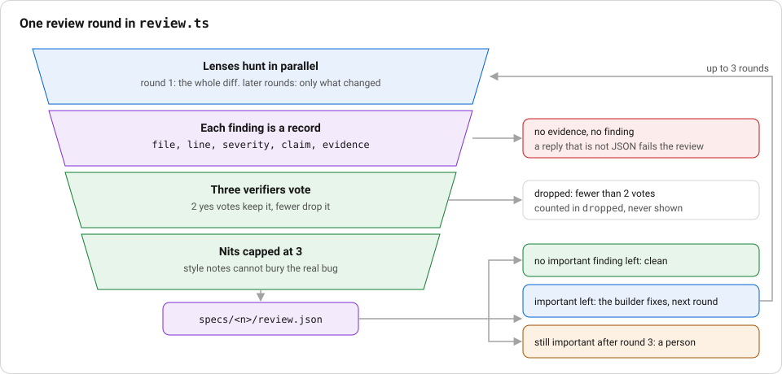

# F5 Review: lenses, voting verifiers and a capped loop

**Stage:** Review. **Layer:** verification. **Workflows:** every workflow ends with a `review` step; `bug-tdd`, `incident` and the others run lenses and voters, then the `plan-drift` check.

## Story

**The ticket.** Issue 35, the build notes in `specs/35/build.md`.

**Without the layer.** The first note says "Blocked: two locked tests cannot pass as written" and proposes changing one. The next update says the blockers "no longer reproduce". A claim with no input that breaks it would have sent a person to chase it.

**What the layer did.** A build note is not held to the review's rule, which is why the rule exists. A review finding must carry `evidence`, "the input that breaks it. No evidence, no finding" (`factory/engine/review.ts`), and two of three verifiers must agree before it reaches a person.



_Notice:_ the side boxes are where findings drop out. Only what passes every layer is written to `review.json`.

## Goal

A review that reports few findings and is right about them. Several lenses hunt in parallel, three cheap verifiers vote on each finding, and only a finding with two votes reaches a person. A later round never repeats an old finding, and after three rounds the rest goes to a human.

## What is built and what is design

Read this before the steps, because the pieces are not all wired the same way.

- Built and tested: `factory/engine/review.ts` (lenses, 3 voters, 2 needed, nit cap, round cap, failed review), `factory/engine/risk.ts`, and `REVIEW.md`. `factory/engine/review.test.ts` proves them.
- Called by the runner: the `review` step in each workflow YAML carries `review: { lenses: [...] }`, and `factory/engine/interpret.ts` runs `reviewLoop` for it (lenses in parallel, 3 voters, 2 needed, a `builder` fix between rounds, cap of 3) and writes `specs/<n>/review.json`. A surviving Important finding or a lens reply that is not findings stops the run as `needs-human`. The `plan-drift` check still runs after it.
- Risk at the human gate: `interpret.ts` calls `classify()` on the files changed so far and requires `Math.max(1, APPROVALS[tier])` distinct people (docs-only still needs one, high needs two) before a `gate: human` step passes.
- Live on pull requests: `.github/workflows/review.yml` runs the `reviewer` agent, and `design-reviewer` for UI paths, and posts one comment ending in a `VERDICT` line. That review has no voting.
- The delivery runner (`factory/run.ts`, `make factory ISSUE=n`) has its own loop: `review`, then `build` to fix, at most `reviewLoop.maxRounds` times (3 in `.factory/config.json`), then the `needs-human` label. It reads one `VERDICT: clean` or `VERDICT: blocking`.

## The pieces

**Lenses.** `.claude/agents/` holds the lens agents: `reviewer`, `security-reviewer` (secrets, input that skips zod, wider permissions), `test-reviewer` (every changed behaviour has a test that fails without it) and `design-reviewer` (overflow, contrast, print clipping at 375 and 1280 px). `reviewRound` takes any list of lens names and runs them with `Promise.all`.

**Findings need evidence.** `findingSchema` requires `file`, `line`, `severity` (`important`, `nit` or `pre-existing`), `claim` and a non-empty `evidence`. A finding with empty evidence fails the schema, so it is discarded.

**Voting.** For every finding, `VOTERS = 3` `verifier` calls answer yes or no. `NEEDED = 2` yes answers keep it. The rest count in `dropped`. The vote count is saved on each kept finding in `review.json`.

**Severity.** Nits are capped at `MAX_NITS = 3`. Important findings are never capped. `pre-existing` marks a problem the diff did not cause.

**A failed review is not a clean one.** If any lens replies with something that is not a findings array, `failed` is true and `reviewLoop` returns `clean: false`.

**Convergence.** `reviewLoop` runs round 1 on the whole diff, later rounds on what changed since. Important findings stay in a carry pool until voters reject them. A finding already kept is not reported again. At `MAX_ROUNDS = 3` it stops with `clean: false`.

**`REVIEW.md`** tells the reviewer what failure looks like here: the count first, `file:line` and the input that breaks it, at most 3 nits, what to skip. `tests/structure/review-and-test-lock.test.ts` checks it keeps those lines. `scripts/check-conventions.ts` lists it as a name Claude Code reads for review guidance. No code in this repo loads it into a prompt.

## Steps

1. Read `REVIEW.md` and `.claude/agents/reviewer.md`, `security-reviewer.md` and `test-reviewer.md` side by side. Note each lens has read tools only.
2. Read `factory/engine/review.ts` top to bottom. Find the three constants.
3. Run the review tests:

   ```
   npx vitest run factory/engine/review.test.ts
   ```

4. Read the workflow review step in `.factory/workflows/bug-tdd.yaml`: `review: { lenses: [reviewer, security-reviewer, test-reviewer] }`. Compare it with `reviewRound`.
5. Open a pull request on your fork. `review.yml` comments with the reviewer's verdict. Compare its comment with the shape `REVIEW.md` asks for.
6. Run the whole workflows proof:

   ```
   make prove LEVEL=workflows
   ```

## Proof that bites

The test is `drops a finding with one vote and keeps one with two` in `factory/engine/review.test.ts`. It feeds one finding and three ballots, once with one yes (expects `dropped` 1) and once with two yes (expects the finding kept).

Make it fail: in `factory/engine/review.ts` change `NEEDED = 2` to `NEEDED = 1`. Run `npx vitest run factory/engine/review.test.ts`. The one-vote case now keeps the finding, so the assertion `dropped` equal to 1 fails. Revert the edit and it passes.

Two more that bite: `keeps an unfixed important finding open until the cap, then hands it to a human` expects `{ clean: false, rounds: 3 }` and two fixer calls. `treats a reply that is not findings as a failed review, not a clean one` fails if a prose reply ever counts as clean.

## Measuring the reviewer

This is only a design here. The idea from Anthropic's code review post is to run the reviewer on pull requests known to be clean and count what it flags, and to turn a missed bug into a reviewer eval. Nothing in this repo runs known-clean pull requests. What exists is the ingredient: `dropped` and the `votes` per finding in `review.json`, so a false-positive rate can be computed from saved files. Treat building that loop as the assignment.

## See it on a real run

There is no `review.json` committed in `specs/`; the engine writes it to `specs/<n>/review.json` on every review round, through `reviewLoop` in `interpret.ts`, for every shipped workflow except `spike`, which has no `review` step (`tests/structure/f5-review-doc.test.ts`). No committed run folder holds one yet, so do not expect one. What is committed is the live evidence of the tests above and the `specs/35/ci.md` record used in F6. To see a real voted review, run any workflow on an issue of your own, then read the `votes` field of each finding in `specs/<n>/review.json`.

## Discussion

1. Two of three voters is a threshold. What does a team lose by moving it to three of three, and what do they lose at one of three?
2. Why must an Important finding carry the input that breaks it, and who checks that input?
3. After three rounds the loop stops and a human decides. What would you want written in that handoff?
