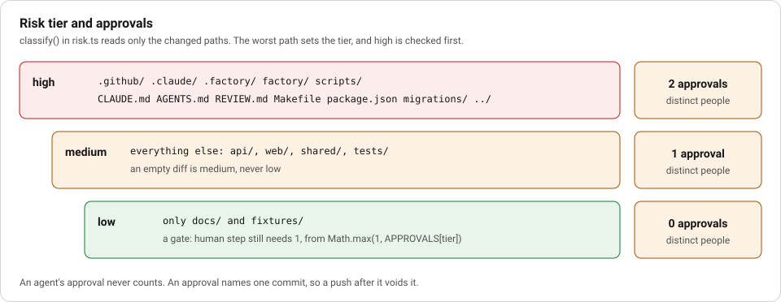

# F6 Deploy: risk tiers, merge queue, CI and release

**Stage:** Deploy. **Layer:** delivery. **Workflows:** the `ci` step in `bug-tdd` and `feature-atdd` (and the others that end with it).

## Story

**The ticket.** Issue 35, the CI stage, in `specs/35/ci.md`.

**Without the layer.** With no `gh` login in the sandbox there was no CI result to read. A stage that summarised from memory would have had nothing to stand on.

**What the layer did.** The `ci` check runs `gh pr checks --watch`, so it cannot pass without a result. The stage wrote "No CI job log was reachable: `gh` is not authenticated in this sandbox", listed the local failures it blamed on the sandbox, and asked a person to "confirm both pass on a real CI runner".



_Notice:_ this ladder sets the count at a human gate today. `release` in `deploy.ts` asks it again before production, once something calls it.

## Goal

Decide how much human approval a change needs from the files it touches, never from who wrote it. Check the change against the latest `main`, watch CI, and release only with the approvals the tier demands on this exact commit.

## What is built and what is design

- Built and tested in `factory/engine/review.test.ts`: `classify` and `approvalsMet` (`risk.ts`), and `release`, `rollback` and `mergeQueue` (`deploy.ts`).
- Called by the runner: `interpret.ts` imports `classify` and `APPROVALS` from `risk.ts` and applies them at every `gate: human` step, with a floor of one person.
- Not called by the runner: nothing imports `deploy.ts`, and `approvalsMet` is used only by `release`. They are a library with proofs, ready to wire.
- Missing target: `deploy.ts` runs `make deploy ENV=<env>`, and this repo's `Makefile` has no `deploy` target. The release and rollback commands therefore have nothing to call here. A learner adds a deploy target for their own host. This is a design, not a working deploy.
- Built and used: the `ci` check in `factory/engine/checks/index.ts` runs `gh pr checks --watch`, and the workflow loop feeds a failure back to the builder.

## The pieces

**Risk tier.** `classify(changed)` returns `low`, `medium` or `high` from paths. High: `.github/`, `.claude/`, `.factory/`, `factory/`, `scripts/`, `CLAUDE.md`, `AGENTS.md`, `REVIEW.md`, `Makefile`, `package.json` and its lockfile, migrations, and any path that escapes the repo. Low: only `docs/` and `fixtures/`. Everything else is medium. Markdown that steers an agent counts as high, because skills and agent prompts are `.md` files. The run's own files (`specs/<n>/intent.md`, `spec.md`, `plan.md`, `run.log`, `review.json`, `lock.json`, `incident.md`) are ignored; any other file under `specs/` is classified. An empty diff is medium, never low.

**Approvals.** `APPROVALS` is low 0, medium 1, high 2. `approvalsMet` counts distinct humans whose approval names the current head commit. An agent's approval never counts, and a push after approval changes the head, so the approval no longer counts.

**Human approval of stages.** Separately, `approvalIn` in `factory/engine/real-host.ts` accepts a stage approval only from a GitHub comment `approve <stage> <digest>` by a configured approver. The agents hold no GitHub token.

**Merge queue.** `mergeQueue` runs `git merge --no-commit origin/main`, runs `make check` on the result, then aborts the merge. It fails on a conflict or a red gate.

**Environment tiers.** `release(host, env, tier, approvals, head)`: `preview` always runs; `production` first checks `approvalsMet` and refuses before running any command.

**Rollback.** `rollback` redeploys a previous tag with `make deploy ENV=<env> TAG=<tag>`. One command.

**Release hook.** `factory/release.ts` bumps the minor version and prepends a changelog entry (`nextVersion`, `changelogEntry`, `prependEntry`). `factory/run.ts` applies it only for an epic whose plan ends with the `DELIVERY: release` line.

**CI babysitting.** The `ci` step runs the `ci` check with `loop: { until: [ci], max: 2 }`. A red CI job goes back to the builder with the evidence, locked tests stay locked, and after two rounds the ticket goes to a human.

## Steps

1. Read `factory/engine/risk.ts`. Predict the tier for `docs/a.md`, `api/src/x.ts` and `.github/workflows/check.yml`.
2. Check your predictions against the tests:

   ```
   npx vitest run factory/engine/review.test.ts
   ```

3. Read `factory/engine/deploy.ts`. Find where production is refused and confirm no command runs first.
4. Read the `ci` step in `.factory/workflows/bug-tdd.yaml`, then the `ci` entry in `factory/engine/checks/index.ts`.
5. Run a real issue through a workflow and read what the `ci` step did:

   ```
   npx tsx factory/engine/main.ts <issue> --workflow=bug-tdd
   ```

   This spends tokens and needs `gh` logged in (`make doctor` checks).
6. Write a `deploy` target in your own `Makefile` that prints its `ENV` and `TAG`, then call `release` from a scratch test to see it run.

## Proof that bites

Test: `never counts an agent, and voids approval after a new commit`, plus `refuses production without approvals before running anything`, both in `factory/engine/review.test.ts`.

Make them fail: in `risk.ts`, change the filter `a.kind === "human"` to accept every kind. The agent-approval assertion `approvalsMet("medium", a, "c1")` is no longer false and the test fails. Or delete the `a.commit === head` clause and the `c2` assertion fails. For the tier, remove `/^\.github\//` from `HIGH` and `is high for a CI workflow and low for docs` fails. Revert each edit.

`merge queue fails when the gate fails on latest main` fails if `mergeQueue` ignores the exit code of `make check`.

## See it on a real run

`specs/35/ci.md` is the record a real `ci` stage wrote on run 35. It states that no CI job log was reachable because `gh` was not authenticated in that sandbox, quotes the only recorded failure from `specs/35/run.log` (`check plan-drift FAIL: files outside plan.md: api/src/agent/template-eval.ts`), says the fix was listing the file in `specs/35/plan.md`, and lists two local test failures it attributes to the sandbox. Read it as an honest example: the stage reported what it could not see instead of claiming green.

No production release has run from this repo, since there is no deploy target.

## Discussion

1. The tier is set by paths, not by author. Which path in your repo would you add to the high list first, and what happened that made you pick it?
2. Why should an approval stop counting when a new commit is pushed?
3. The merge queue checks the change on the latest `main`. What does a green branch tell you that this does not, and the reverse?
