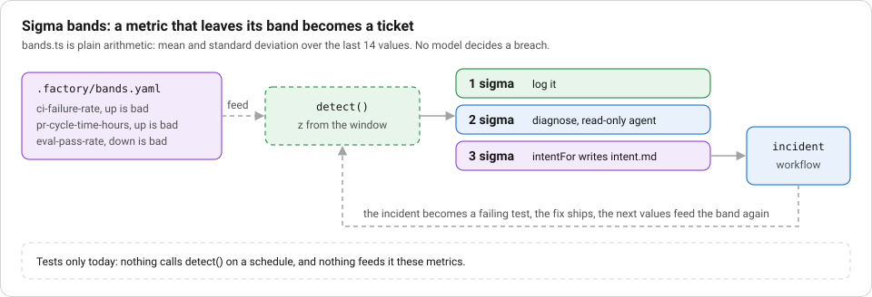

# F7 Maintain: bands, incident to eval, retro and metrics

**Stage:** Maintain. **Layer:** sharing and feedback. **Workflows:** `incident` (diagnose, plan, eval, fix, review).

## Story

**The ticket.** None yet. Nothing feeds `detect` its metrics, so no run has breached a band. The story is the test.

**Without the layer.** A drifting metric needs someone to notice it on a chart.

**What the layer did.** `a 3 sigma breach writes an intent` in `factory/engine/review.test.ts` feeds a value of 30 against a history near 10 and expects a new `intent.md`. Arithmetic turns the drift into a ticket, with no model deciding.



_Notice:_ the dashed parts are the ones only tests reach today.

## Goal

After a change ships, the factory watches itself. A metric that leaves its band becomes a ticket. An incident becomes a failing test before it becomes a fix. A lesson from a run is kept only if the eval score did not fall.

## What is built and what is design

- Built and tested: `bands.ts` (`detect`, `actionFor`, `intentFor`), `metrics.ts`, the `incident` workflow, and the engine `retro.ts`.
- Wired: `runIssue` in `cli.ts` writes `.factory/runs/<n>/metrics.json`, and `--report` rolls them up. Those run folders are gitignored, so no run data is committed.
- Not wired: nothing calls `detect` on a schedule, and nothing feeds it the three metrics in `.factory/bands.yaml`. The engine `retro()` in `factory/engine/retro.ts` is not called by the runner, and its eval command must print `SCORE <number>`; no script in this repo prints that line. The runner in `factory/run.ts` has its own retro that only posts a proposal comment for a human to apply.
- DORA: there is no code for deployment frequency, lead time, change failure rate or time to restore. Treat the mapping below as a design.

## The pieces

**Sigma bands.** `.factory/bands.yaml` lists `ci-failure-rate`, `pr-cycle-time-hours` (both up is bad) and `eval-pass-rate` (down is bad), each with a window of 14. `detect` takes the history before the latest value, computes mean and standard deviation, and returns a breach of 0, 1, 2 or 3 sigma. No model decides this. `actionFor` maps 1 to log, 2 to diagnose with a read-only agent, 3 to a new `intent.md`, written by `intentFor`.

**Incident to eval.** `.factory/workflows/incident.yaml`: `diagnose` (the `verifier` agent writes `intent.md` and changes nothing), `plan`, `eval` (the builder writes a test in `specs/<issue>/golden` that must fail on the base commit, checked by `red` and `lock`), then `fix` (checks `green`, `lock`, `gate`) and `review`. The test exists and fails before the fix is allowed.

**Retro with a delta.** The `factory-retro` skill (`.claude/skills/factory-retro/SKILL.md`) proposes at most one change. `retro()` scores before, applies the change with the builder, scores after, and reverts if the score fell. It refuses a file outside `.claude/skills/` or `.claude/rules/` markdown, a change that touches any other file, and a change to the frontmatter (tools and hooks). The result carries `before`, `after` and `delta`.

**Metrics.** `metricsFor` stores ticket, workflow, outcome, rounds per step and cost. `rollup` returns runs, first-pass rate, done rate, mean rounds, total cost and cost by workflow. A run is first pass when it finished and every step took one round.

## DORA, as a design

Four measures and where they could come from. Deployment frequency and lead time need merge timestamps from `gh`. Change failure rate needs incident tickets linked to a release. Time to restore needs the incident open and close times. None is computed here. First-pass rate and done rate are the nearest leading metrics the code does produce.

## Steps

1. Read `.factory/bands.yaml` and `factory/engine/bands.ts`.
2. Run the bands and metrics tests:

   ```
   npx vitest run factory/engine/review.test.ts factory/engine/metrics.test.ts factory/engine/retro.test.ts
   ```

3. Read `.factory/workflows/incident.yaml` and say which step first produces a failing test.
4. Run a real issue, then the roll-up:

   ```
   npx tsx factory/engine/main.ts <issue> --workflow=incident
   npx tsx factory/engine/main.ts --report
   ```

5. Pick a metric from `bands.yaml` and write a script that feeds `detect` its last 14 values. Print the action.
6. Write a script that prints `SCORE <number>` from your eval and pass it to `retro()` in a scratch test.

## Proof that bites

Tests in `factory/engine/review.test.ts`: `a 3 sigma breach writes an intent` and `a value inside the band does nothing`. In `bands.ts`, change `z >= 3 ? 3` to `z >= 4 ? 3` and the first test fails, since a breach of 30 against a history near 10 no longer reaches the intent action.

Retro: `reverts a lesson that lowered the score` in `factory/engine/retro.test.ts` feeds scores 0.9 then 0.7 and expects `reverted`. Change `delta < 0` to `delta < -1` in `engine/retro.ts` and it fails. `treats a missing SCORE line as a broken eval` fails if a silent eval counts as zero.

Metrics: `counts a run first-pass only when it finished with no repeat round` in `metrics.test.ts`.

## See it on a real run

No `metrics.json`, `incident.md` or retro result is committed, because `.factory/runs/` is ignored and the incident workflow has no committed run. After your own run, `.factory/runs/<n>/metrics.json` is the artifact to read, and `specs/<n>/run.log` shows each step and round. Do not quote numbers from anywhere else.

## Discussion

1. Why is the sigma check plain arithmetic and not a model's opinion?
2. A retro lesson raised the eval score by a little on one run. What would make you keep it, and what would make you distrust it?
3. Which DORA measure would your team be most embarrassed to see, and which data would you need to compute it?
