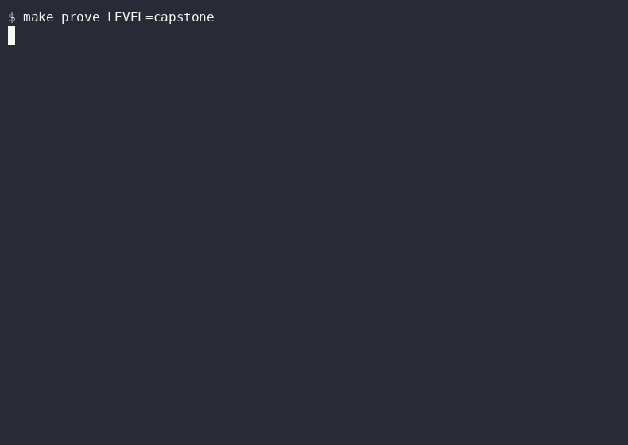

# Capstone: rebuild a feature through your own factory

**Layer:** everything before it. **Proof:** `make prove LEVEL=capstone`.

## Goal

Take the specs that go red when the feature is stripped out and turn them green by running your own factory, not by typing the code. The finished tree is the reference answer you compare against afterwards.

## The problem

Every earlier level taught one part of the factory on a small task. None of them showed the parts working together on a feature that spans the shared package, the api and a cache. Until one real feature goes through the whole line, nobody knows which gate is missing.

## Without

Ask a model to "add workbooks and templates" in one session. It writes code and tests together, so the tests agree with the code whatever the code does. Nothing was red first, and nothing says the template path really skips the model.

## The code

- `shared/src/workbook-*.ts`, `shared/src/render-workbook.ts` and `shared/src/template.ts` plan, validate, check and render a multi-chapter workbook and a template made of slots.
- `api/src/cache/` holds the exact-prompt cache. `api/src/templates/` distills a good sheet into a template, names it with a strict id and stores it.
- `api/src/agent/workbook-agent.ts`, `fill-template.ts` and `template-eval.ts` run the workbook agent, fill only a template's slots, and compare output tokens with and without a template.
- `specs/34`, `specs/35` and `specs/37` hold the red suites. They belong to the workflows level and fail once the code is stripped.
- `scripts/capstone-strip.ts` lists those files in one place and deletes them from a copy of the tree. The earlier levels own the same files, because the api server imports them.

## With

On a stripped copy the three spec folders fail because the code they import is missing. On `supplied/capstone` they pass, and the unit tests beside the code pass too.

## Run it

1. Type `make levels LEVEL=workflows`, then `cp -R supplied/workflows /tmp/capstone-start`, `npx tsx scripts/capstone-strip.ts /tmp/capstone-start`, `cd /tmp/capstone-start` and `npm ci`.
2. Type `npx vitest run specs/34 specs/35 specs/37`. Expect red, and read the first failure.
3. Run your factory on a ticket that names the spec folder. Follow [the capstone factory guide](../factory/f9-capstone.md).
4. Type `make levels LEVEL=capstone` and diff your result against `supplied/capstone` for the files listed above.

## Prove it

`make prove LEVEL=capstone` runs the three spec folders and the unit tests beside the workbook, template, cache and route code. It passes only when all of them pass.

## Exercise

Track A: from a clean `supplied/workflows`, get `specs/37` green through the bug workflow and read the run log for the step that first produced a red test. Track B: get `specs/35` green, then change the cache key so it ignores the band and watch which golden test fails.

## Discussion

Where did your factory stop and ask a person, and was that the right place? Which gate would you add before running it on a feature you could not check yourself?
