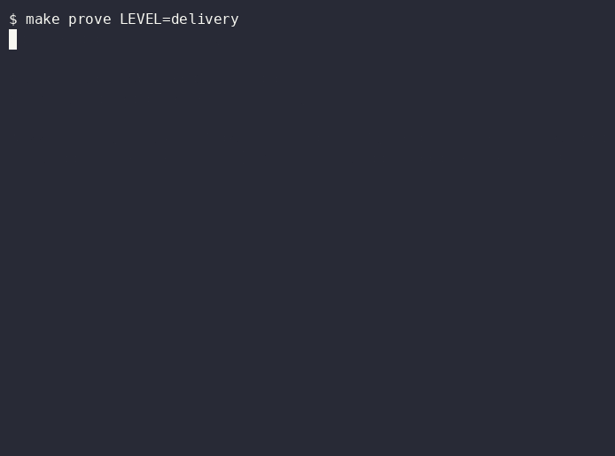

# Delivery: tickets flow to a pull request, a human merges

**Layer:** delivery. **Proof:** `make prove LEVEL=delivery`.

## Goal

An orchestrator files tickets. Stage agents triage, plan, build, review and verify them. A person approves the plan and merges the result.

## The problem

Handing an agent a ticket and walking away gives you an unreviewed change. Handing it a ticket with no cap on review rounds gives you a loop that burns budget.

## Without

Run one agent on a ticket with no stages. There is no plan to approve and no evidence on the pull request.

## The config

- `factory/run.ts` is the state machine. Order is fixed in code: triage, plan, approval, build, a review loop capped by `reviewLoop.maxRounds`, then verify.
- Approval binds to one plan. Posting a plan clears the approved label. A build starts only when the issue already has both planned and approved labels, so a stale approval cannot start a build.
- The review loop stops at the cap and labels the issue `needs-human`.
- `factory/stages.ts` runs each stage with the Agent SDK, project settings only, strict MCP, an allowlisted environment and a fail-closed model check. Issue text is passed as untrusted data.
- `.github/PULL_REQUEST_TEMPLATE.md` ends with "A human merges this".
- `.github/workflows/check.yml` runs the gate on trunk and on every level snapshot.

## With

The same ticket now moves through named stages, and a person decides twice: the plan and the merge.

## Run it

1. File an issue with `gh issue create`. Run `make factory ISSUE=<n>`. Expect a plan comment and a stop at awaiting approval.
2. Read the plan. Add the approved label.
3. Run `make factory ISSUE=<n>` again. Expect build, review and verify, then a result of `pr-ready` or `needs-human`.

## Prove it

`make prove LEVEL=delivery` runs the dry run, checks the six stages appear in order with the loop cap, and checks the PR template. The state machine tests use a fake runner and cover approval, order, the cap, routing and the unlisted-model failure.

## Exercise

Track A: file a bug ticket for the Kindergarten parser and run it through the dry run. Track B: add a retro stage that proposes one change to `.claude/` and must keep the eval score.

## Go further: headless and bounded

- `claude -p "classify this issue" --output-format json` runs one turn without a screen and prints JSON you can pipe to `jq`.
- Every factory stage has `maxTurns` and `maxBudgetUsd` in `.factory/config.json`. Lower one to a value too small, run the stage, and read the stop reason. A run that ends at its budget is a feature, not a failure.
- `.github/workflows/review.yml` runs a review on a pull request with a model and a turn cap set in the workflow.

## Discussion

Which step in your delivery should never be automated, and who owns it?
