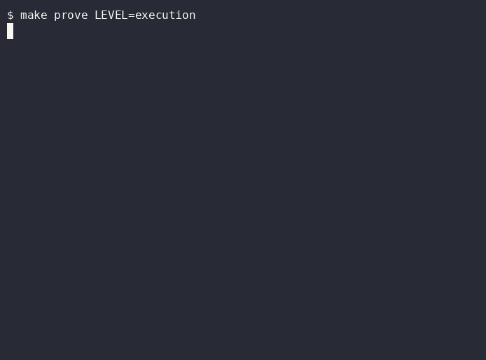

# Execution: every agent and stage is bounded

**Layer:** execution. **Proof:** `make prove LEVEL=execution`.

## Goal

One giant session becomes small agents with a model, a turn cap, a tool list and a budget each.

## The problem

A single long session carries every file it ever read. Context grows, cost grows, and one wrong turn is expensive. Nothing says what the planner may do versus the builder.

## Without

Ask one session to plan, build and review a feature. Watch `/context` fill.

## The config

- `.claude/agents/planner.md`, `builder.md`, `reviewer.md`, `verifier.md`. Each names a model alias, `maxTurns` and `tools`. The builder runs in its own worktree.
- `.factory/config.json` lists six stages, each with a model, turn cap, dollar budget and permission mode. It also lists the allowed models and routes: an epic plan goes to Opus, docs work goes to Haiku.
- `factory/config.ts` validates the file with zod.

## With

Run `make factory ISSUE=1 FLAGS=--dry-run`. It prints each stage with its limits and the review-loop cap. The main session stays small because stages run elsewhere.

## Run it

1. Type `make factory ISSUE=1 FLAGS=--dry-run`. Expect six stages in order.
2. Open `.factory/config.json`. Change the build model to one not in `allowedModels`. Expect the proof to fail.
3. Revert it.

## Prove it

`make prove LEVEL=execution` checks every agent has `model`, `maxTurns` and `tools`, the config validates, every stage model is allowed, and prints the worst-case cost of one pass.

## Exercise

Track A: add a stage budget and see the worst case change. Track B: write a new agent for accessibility review.

## Go further: effort, parallel sessions and orchestration

- Models are routed per stage in `.factory/config.json`. Read `cost.json` from a run to see what each stage spent, and lower the effort on the stages that spent most for the least gain.
- Two terminals, each on its own worktree (`git worktree add`), run two sessions at once without overwriting each other. The builder agent uses `isolation: worktree` for the same reason.
- Pick the orchestration by what you need back:

| Need                                | Use                                                  |
| ----------------------------------- | ---------------------------------------------------- |
| A result from one focused read      | a subagent                                           |
| A fixed order of stages with caps   | the factory runner or `.claude/workflows/factory.js` |
| Many independent runs of one prompt | `claude -p` in a loop                                |

## Discussion

What does one runaway stage cost you today?
