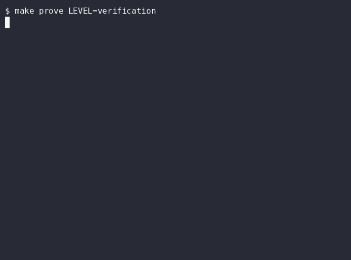

# Verification: a fix is real only if its test bites

**Layer:** verification. **Proof:** `make prove LEVEL=verification`.

## Goal

Claude cannot finish on a red gate, and every fixed bug has a test that fails without the fix.

## The problem

Three bugs hide in this app. "Kindergarten" falls through to the wrong band because the parser only matched digits. The page drops the assistant's question from the history, so the agent asks it again. The preview overflows a 375 px phone. Happy-path tests pass on all three.

## Without

Reintroduce one fix by hand and ask Claude to finish. It stops, says done, and the bug ships.

## The config

- `.claude/hooks/posttooluse-typecheck.mjs` runs after each edit and returns type errors to Claude at once.
- `.claude/hooks/stop-gate.mjs` runs lint, types and tests when Claude tries to stop. Exit 2 sends the failure back as its next task. It honours `stop_hook_active` so it never loops.
- `tests/structure/bands.test.ts` walks every band and alias. `web/src/lib/history.test.ts` and `layout.test.ts` pin the other two bugs.

## With

Break the code and let Claude try to stop. The gate refuses and prints the failure.

## Run it

1. Open `shared/src/bands.ts` and break `parseBand`. Ask Claude to stop. Expect the stop to be refused.
2. Fix it. Expect the stop to go through.
3. Type `make prove LEVEL=verification`.

## Prove it

The proof undoes each fix in turn, runs the named test, expects it to fail, then restores the file. It also checks both hooks are wired in `.claude/settings.json`. Expect `3 bugs bite, hooks wired`.

The layout test reads the page source. A browser replay with Playwright and axe is the next step and is part of the take-home.

## Exercise

Track A: add a fourth bug and its biting test. Track B: replace the layout test with a Playwright check at 375 px.

## Go further: let a tool look

A hook that fails the turn is a check you cannot forget. The `design-reviewer` agent adds eyes: it builds the app, opens it at 375 and 1280 px and reports sideways scroll, low contrast and print clipping. Run it after changing a font size and compare its verdict with `tests/e2e/layout.e2e.ts`, which asserts no sideways scroll, no serious accessibility violation and no clipped print page.

## Go further: review rules and a test lock

`REVIEW.md` tells the reviewer what failure looks like here: the count first, `file:line` evidence, at most three nits. The `pretooluse-test-lock.mjs` hook blocks edits to test files while `FACTORY_PHASE=fix`, so a fix cannot pass by changing the test. Set the variable in a shell and try to edit a test to see it refuse.

## Discussion

How many of your bug fixes would still pass their test with the fix removed?
