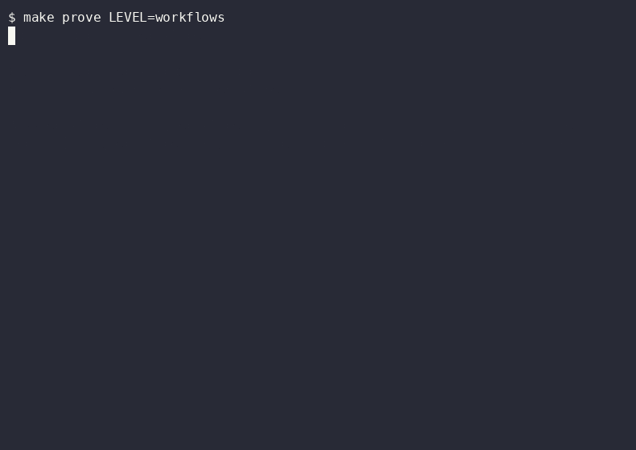

# Workflows: one engine, a workflow per kind of task

**Layer:** delivery, made configurable. **Proof:** `make prove LEVEL=workflows`.

## Goal

A factory that runs the right workflow for the ticket. A bug runs red, fix, mutation. A feature runs spec, human gate, tests, build. Each workflow is a file, and every gate is code that reads exit codes, not the model's word.

## The problem

The delivery level has one fixed order. A bug, a refactor and a UI change need different evidence, and a fixed order either skips evidence or asks for evidence the task cannot give.

## Without

Run a bug and a refactor through the same stages. The bug never proves its test failed first. The refactor never proves behaviour stayed put.

## The config

- `.factory/workflows/<name>.yaml` holds one workflow. Each step names a stage, an agent from `.claude/agents`, the checks it must pass, an optional loop with a cap, and an optional human gate. The first line names the method and its source.
- `factory/engine/workflow.ts` parses a workflow with zod and refuses an unknown check or a loop on a check the step does not run.
- `factory/engine/interpret.ts` runs the steps in order. A loop repeats the agent with the failing checks' evidence until they pass or the cap is hit, then hands the ticket to a human.
- `factory/engine/checks/` holds the checks. `red` fails a test that already passes on the base commit. `lock` hashes every test file in runner state the agent cannot write. `plan-drift` fails a diff that strays from `plan.md`.
- `factory/engine/review.ts` runs review lenses in parallel, then three verifiers vote on each finding and only two votes keep it. A reply that is not findings is a failed review.
- `factory/engine/risk.ts` sets the tier from the paths changed. An agent's approval never counts and an approval covers one commit.
- `factory/engine/bands.ts` turns a metric breach into a response: log, diagnose, or write an `intent.md`.
- `.claude/settings.json` denies reading `.factory/holdout/**`, so the builder cannot see the cases that grade it.

## With

The bug workflow cannot reach its fix step until a test has failed on the base commit, and it cannot finish if the fix moved that test.

## Run it

1. Read `.factory/workflows/bug-tdd.yaml` and `feature-bdd.yaml` side by side.
2. Run `npx vitest run factory/engine` and read the dry run for each workflow.
3. Change `max` on a loop to 1 and watch the dry run in `workflows.test.ts` stop at the cap.

## Prove it

`make prove LEVEL=workflows` runs the engine tests: every workflow parses and runs in order, `red` refuses a passing test, `lock` catches an edited test, a one-vote finding is dropped, a CI workflow change is the high risk tier, and a 3 sigma breach writes an intent.

## Exercise

Track A: add a `typo` workflow for a one-line docs fix with only the `prose` check, and see the workflow test pick it up. Track B: add a check that fails when a changed file has no test beside it, and give it a failing input first.

## Discussion

Which check would your team trust to say done, and what would it have to read to earn that?
